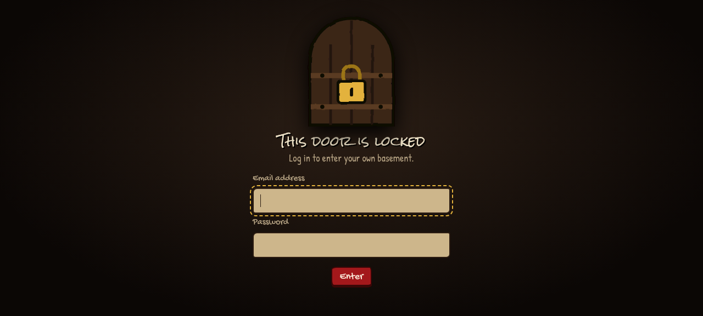
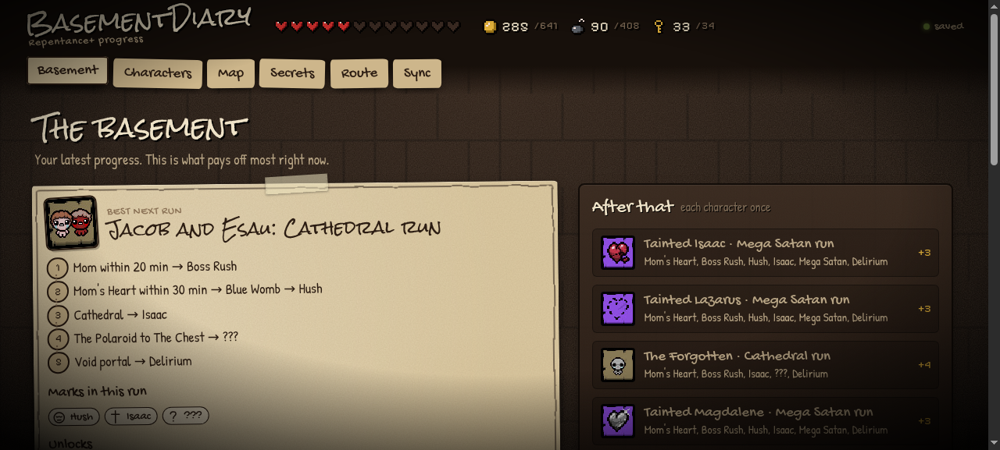
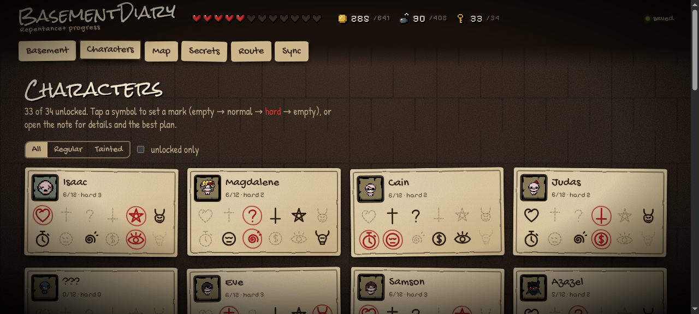
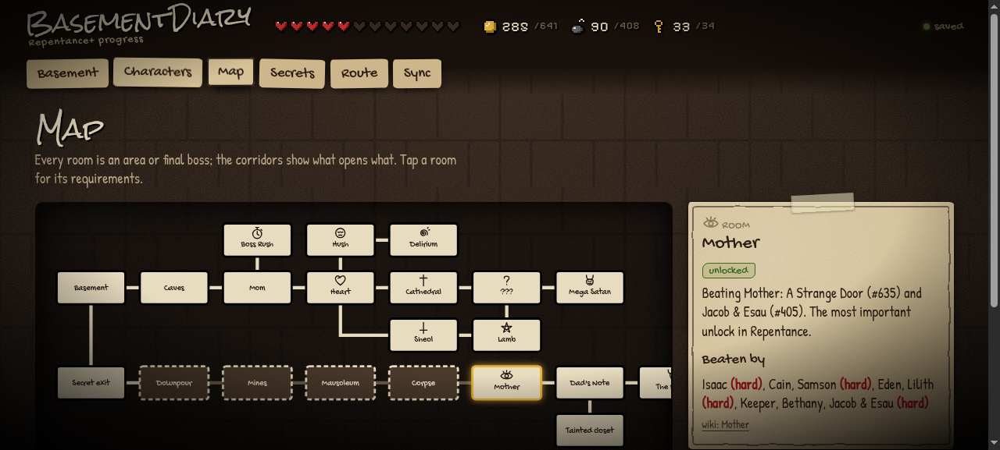
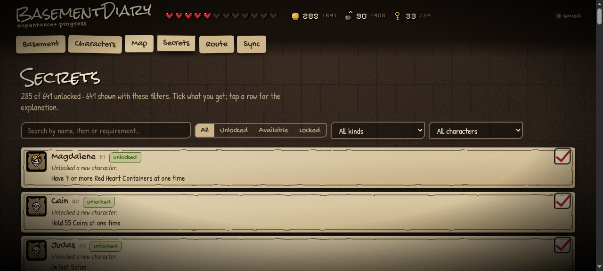
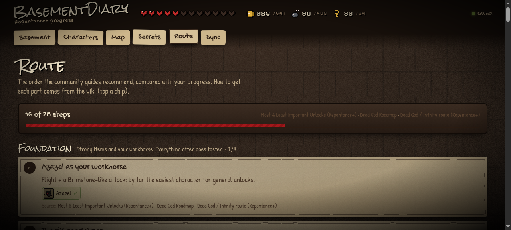

# BasementDiary

A self-hosted progress tracker for **The Binding of Isaac: Repentance+**, styled after the
game: a dark basement, paper notes and a pixel HUD.

BasementDiary reads your real save file, works out what each unlock depends on, and tells
you which run pays off most next, from your first run to Dead God. Every account keeps its
own progress, and on Windows your save can sync by itself each time you quit the game.

> **Status:** version 1.0.0 &nbsp;·&nbsp; **License:** [PolyForm Noncommercial 1.0.0](LICENSE)
> (application code only; see [License](#license)) &nbsp;·&nbsp; Fan project, not affiliated
> with Nicalis or Edmund McMillen.

**Jump to:** [Self-hosting](#self-hosting-on-linux-quickstart) ·
[Windows sync](#playing-isaac-with-automatic-sync-windows) ·
[Configuration](#configuration) · [Development](#local-development) · [License](#license)

## Screenshots

<p align="center">
  
</p>
<p align="center"><em>The public login screen. Everything else is behind an account.</em></p>

The signed-in screens below use synthetic demo progress; no private user data is included.

<p align="center">
  
</p>
<p align="center"><em>Basement dashboard with progress at a glance.</em></p>

<p align="center">
  
</p>
<p align="center"><em>Character completion marks and progress.</em></p>

<p align="center">
  
</p>
<p align="center"><em>Progression map for the major game paths.</em></p>

<p align="center">
  
</p>
<p align="center"><em>Searchable secret and achievement unlocks.</em></p>

<p align="center">
  
</p>
<p align="center"><em>Recommended route order and current progress.</em></p>

## Features

- **All your unlocks**: 641 achievements, 34 characters, 408 completion marks (normal and hard).
- **Real dependencies**: anything still locked shows the chain of what you have to do first,
  e.g. Downpour only after *A Secret Exit*, The Beast only after *A Strange Door*.
- **Ticking off**: tap a mark (empty → normal → hard); the unlocks that come with it follow.
- **Route advice**: the best next runs per character and overall, plus your place in a meta
  route based on popular Steam guides. Unlocks worth postponing are flagged and skipped.
- **Unlock details**: Item Quality (Q0–Q4) for item unlocks and a short tip per challenge.
- **Sync**: import your save file, fill gaps from Steam achievements, or sync automatically
  on Windows.
- **Accounts**: email and password, with progress kept per account. Registration is closed
  until the admin opens it.

## Requirements

| To… | You need |
|---|---|
| Self-host | A Linux server with Docker and Docker Compose, a domain, and an HTTPS reverse proxy (e.g. nginx with Let's Encrypt) |
| Develop locally | Node.js 20 or newer |
| Sync automatically | Windows with Windows PowerShell 5.1 (built into Windows 10/11), and The Binding of Isaac: Rebirth + Repentance+ on Steam |

## Self-hosting on Linux (quickstart)

With your domain's DNS pointing at the server:

```bash
git clone https://github.com/raylano/Binding-Of-Isaac-Progress-Tracker.git ~/BOIPT && cd ~/BOIPT
cp .env.example .env
chmod 600 .env
```

Edit `.env` with your own values (never commit it), and for the first start set
`ADMIN_PASSWORD` to a unique one-time password of at least 12 characters:

```
PUBLIC_URL=https://your-domain.example
ADMIN_EMAIL=you@example.com
ADMIN_PASSWORD=
PORT=8090
TRUST_PROXY=1
```

```bash
docker compose up -d --build
curl -fsS http://127.0.0.1:8090/api/health    # {"ok":true} (use your PORT if changed)
```

The first start creates the admin account. Then empty `ADMIN_PASSWORD` in `.env` and run
`docker compose up -d` again. Registration stays closed until the admin opens it under
*Sync → Admin*.

The app is published on `127.0.0.1` only, so your reverse proxy must handle HTTPS.
[DEPLOY.md](DEPLOY.md) covers DNS, nginx and TLS, updates, backups and troubleshooting.

## Playing Isaac with automatic sync (Windows)

Install The Binding of Isaac: Rebirth and Repentance+ through Steam and sign in to Steam.
Below, `https://your-domain.example` stands for your server's address; the *Sync* page on
the site shows it, together with the exact command.

1. Download or clone this repository and keep it in a fixed place; the shortcut runs
   `tools/sync-save.ps1` from there.
2. Run this once in PowerShell from the repository folder:

   ```powershell
   powershell -ExecutionPolicy Bypass -File tools\sync-save.ps1 -Server https://your-domain.example -InstallShortcut
   ```

   Without `-Server`, the script asks for the server address.
3. Log in with your email address and password. New accounts only work while the admin has
   registration open.
4. Always start Isaac with the **Isaac + sync** desktop shortcut: it launches the game via
   Steam and uploads your save as soon as you quit.

Your password is never stored; this PC gets a sync token you can revoke under
*Sync → Account*. Run the script with `-ResetLogin` to switch accounts or servers. All
options: [DEPLOY.md](DEPLOY.md#8-windows-sync-your-save-automatically).

## Configuration

All settings are environment variables, read from `.env`; see [.env.example](.env.example).

| Variable | Meaning |
|---|---|
| `PUBLIC_URL` | Public HTTPS origin shown in the sync command (HTTP allowed for localhost; empty uses the page's own address). |
| `ADMIN_EMAIL` | The account with this address is the admin and can open or close registration. |
| `ADMIN_PASSWORD` | One-time: creates the admin account on first start. Remove it afterwards. |
| `PORT` | Host port, bound to 127.0.0.1 under Docker. |
| `TRUST_PROXY` | Number of proxies in front of the app (`1` behind nginx, `0` locally). |
| `STEAM_API_KEY` | Optional Steam Web API key. Without it the public profile page is used. |

## Accounts and security

- Passwords need at least 12 characters; sign-in and token requests are rate-limited per IP.
- Browser sessions and sync tokens can be revoked at any time under *Sync → Account*.
- Keep `.env` and `data/` (accounts, sessions, progress) private, including backups.

## Local development

```bash
npm install
cp .env.example .env
```

Edit `.env` for local use, setting `ADMIN_PASSWORD` to a password of at least 12 characters
for the first start:

```
PORT=8090
PUBLIC_URL=http://localhost:8090
TRUST_PROXY=0
ADMIN_EMAIL=you@example.com
ADMIN_PASSWORD=
```

```bash
npm run dev
```

The site runs on `http://localhost:$PORT`. The first start creates the admin account for
`ADMIN_EMAIL`; remove `ADMIN_PASSWORD` from `.env` afterwards and log in.

### Tests

```bash
npm test
```

To include your real save as well (never committed):

```bash
ISAAC_SAVE="C:/Program Files (x86)/Steam/userdata/<id>/250900/remote/rep+persistentgamedata1.dat" npm test
```

## Limitations

- **Automatic sync is Windows-only.** Elsewhere, upload your save on the site or use Steam.
- **Steam sync needs public game details** ("Game details" set to Public in Steam privacy).
- **No account self-service**: no deletion, password reset, 2FA or email; the server sends no mail.
- **Single process.** Run one server process per data directory.
- **Item Quality covers collectibles only**, not trinkets, cards, runes, pills or pickups.

## License

Original BasementDiary application code is licensed under the
[PolyForm Noncommercial License 1.0.0](LICENSE); commercial use requires separate permission.
Third-party software, data, content, fonts, game assets and trademarks are not covered and
stay under their own terms (see below).

## Sources

- Unlock requirements: [Binding of Isaac: Rebirth Wiki](https://bindingofisaacrebirth.wiki.gg/wiki/Achievements) (CC BY-SA 3.0).
- Save format: [REPENTOGON EventCounter](https://repentogon.com/enums/EventCounter.html) and [isaac-save-edit-script](https://github.com/jamesthejellyfish/isaac-save-edit-script) (MIT).
- Route advice: Steam guides [Most & Least Important Unlocks](https://steamcommunity.com/sharedfiles/filedetails/?id=2994836310), [Dead God Roadmap](https://steamcommunity.com/sharedfiles/filedetails/?id=2980920774), [Dead God / Infinity route](https://steamcommunity.com/sharedfiles/filedetails/?id=3712501774).
- Item Quality: [Item Quality](https://bindingofisaacrebirth.wiki.gg/wiki/Item_Quality) on the Rebirth Wiki (CC BY-SA 3.0) and [Platinum God](https://www.tboi.com/all-items); badge styling follows [External Item Descriptions](https://github.com/wofsauge/External-Item-Descriptions).
- Challenge tips: summarised from the Rebirth Wiki challenge pages (CC BY-SA 3.0).
- Fonts (OFL): Rock Salt, Gochi Hand, Patrick Hand, Pixelify Sans.
